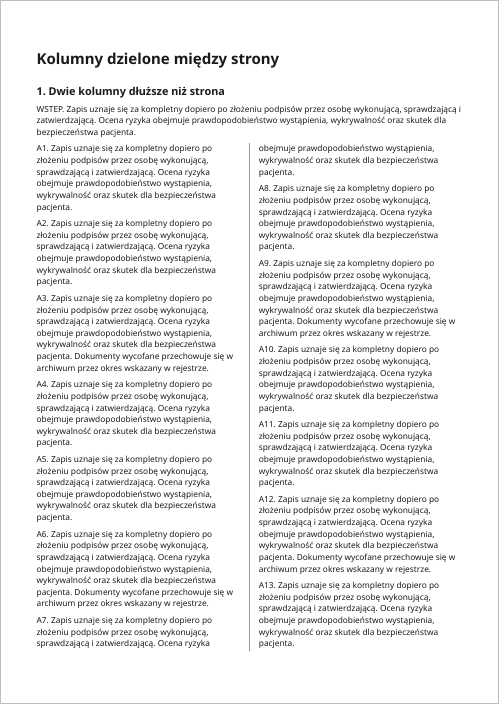

# gopdfgo

Prints HTML + CSS + SVG documents to PDF in pure Go: no browser, no JavaScript, no cgo. Made for the documents
businesses print (invoices, reports, financial statements, long tables, books) with CSS Paged Media: page
margins and headers, tables of contents with page numbers, footnotes, PDF/A, PDF/UA and Factur-X. The same
input always gives the same PDF, byte for byte.

```go
import "github.com/polestorm/gopdfgo/htmlpdf"

result, err := htmlpdf.Render(ctx, html, htmlpdf.Options{Fonts: fonts})
// result.PDF
```

## Why gopdfgo

Compared with headless Chromium and with [folio](https://github.com/carlos7ags/folio), another HTML to PDF
engine in Go (details in [Comparison](#comparison)):

- **Prints like a browser**: the same page count as Chromium on 33 of 35 test documents, words a median 0.2 pt
  from where Chromium puts them.
- **Does what browsers don't do for print**: tables of contents with page numbers (`target-counter()`), "page X
  of Y" in the text, footnotes, all 16 margin boxes, running headers, hyphenation for 24 languages built in.
- **Archival and accessible output**: PDF/A-2 and PDF/A-3 (levels b and a), PDF/UA-1 and Factur-X e-invoices,
  checked with veraPDF and Mustang; PAdES signatures in an optional package.
- **One small program**: a single Go binary of 25 MB instead of a 460 MB browser, 2–9 times faster than
  Chromium on business documents and with a tenth of its memory. Fonts and files come only from the caller;
  nothing is read from the disk or the network unless you allow it.
- **Standards first**: the layout follows the W3C specifications and is tested on their test suites: 9484 of
  10962 CSS reftests, 310 of 340 print reftests, 194 of 235 SVG reftests.

Where it is weaker: folio is about 2.8 times faster and uses less memory, and neither gopdfgo nor folio runs
JavaScript. gopdfgo has no right-to-left or vertical text yet.

## Contents

- [Why gopdfgo](#why-gopdfgo) · [Comparison](#comparison) · [Examples](#examples) · [Status](#status) ·
  [Documentation](#documentation) · [How the comparison was measured](#how-the-comparison-was-measured) ·
  [License](#license)
- [Usage](docs/usage.md): fonts, resources, PDF/A and PDF/UA, Factur-X, signatures, command line, what is
  and is not supported

## Comparison

Compared with headless Chromium, the usual way to print HTML from a server, and with folio, a younger Go library
with its own layout engine and an HTML converter.

| | gopdfgo | Chromium 157 | folio |
|---|:---:|:---:|:---:|
| Approach | WeasyPrint's layout model ported to Go, extended | a web browser printing a page | own layout engine in Go |
| Dependencies[^deps] | 7 Go modules | a browser process and system libraries | 3 Go modules 🥇 |
| Program size[^size] | 25 MB | about 460 MB on Linux | 12 MB 🥇 |
| Invoice, 3 pages[^bench] | 62 ms | 430 ms | 22 ms 🥇 |
| Book, 255 pages | 1.1 s | 2.1–2.6 s | 0.48 s 🥇 |
| Book with a table of contents | 1.4 s 🥇 | no page numbers | not supported |
| Memory, business documents | 48–117 MB | about 950 MB | 22–80 MB 🥇 |
| Memory, book | 0.42 GB | 1.7 GB | 0.29 GB 🥇 |
| PDF size, invoice[^pdf] | 25–51 kB 🥇 | 27–53 kB | 26–56 kB |
| PDF size, book | 26.3 MB 🥇 | 27.6 MB | 26.7 MB |
| Same page count as Chromium[^fidelity] | 33 of 35 🥇 | reference | 17 of 35 |
| Words on the same page as in Chromium | 92% 🥇 | reference | 35% |
| Median offset of words from Chromium | 0.2 pt 🥇 | reference | 55 pt |
| Deterministic output | yes, tested on 46 756 renders 🥇 | no (dates, identifiers) | yes, by design |
| Unsupported CSS | reported as warnings 🥇 | developer console | ignored silently |
| JavaScript | no | yes 🥇 | no |
| Flexbox, grid, multi-column | yes (no `subgrid`) | yes 🥇 | partly |
| `@page` margin boxes | 16 of 16 🥇 | 16 of 16 🥇 | 6 of 16 |
| Running headers (`string-set`, `running()`) | both 🥇 | neither | `string-set` |
| Table of contents with page numbers | yes 🥇 | no | no |
| "Page X of Y" in the text | yes 🥇 | margin boxes only | no |
| Footnotes (`float: footnote`) | yes 🥇 | no | no |
| Hyphenation | 24 languages built in 🥇 | system dictionaries | English |
| SVG | yes | yes 🥇 | basic shapes |
| Right-to-left and vertical text | no | yes 🥇 | right-to-left |
| PDF/A | 2b, 2a, 3b, 3a 🥇 | no | yes |
| Tagged PDF, PDF/UA | PDF/UA-1, checked with veraPDF 🥇 | tagged | tagged |
| Factur-X / ZUGFeRD | yes, checked with Mustang 🥇 | no | yes |
| PAdES signatures | B-B, B-T, B-LT; fields placed in HTML (optional package) | no | B-B to B-LTA 🥇 |
| Forms, barcodes, editing PDF files | no | no | yes 🥇 |
| License | Apache 2.0 | BSD-3-Clause | Apache 2.0 |
| GitHub popularity[^pop] | new | Chromium itself | 884 stars, 61 forks |

[^deps]: Go modules the program needs (`go version -m`). gopdfgo: go-text (shaping), benoitkugler/pdf and
    pstokenizer (PDF writing), hhrutter/lzw and three `golang.org/x` modules; all pure Go.
[^size]: The command-line program as built by `go build` on macOS arm64 on 2026-11-24 (folio at commit
    `29bca95`); gopdfgo includes 24 hyphenation dictionaries. Chromium: the headless shell with its libraries on
    Linux; the macOS application is 2.2 GB.
[^bench]: Whole process. Business documents: Polish e-invoices and financial statements of 1–16 pages.
    Measured 2026-11-20 to 2026-11-24 on one Apple M4 laptop with the same input and fonts
    for every engine; details and per-document numbers in [`docs/comparison.md`](docs/comparison.md). folio is about
    2.8 times faster than gopdfgo on typical documents (median of 36), from 1.0 to 5.4 times. Chromium's time
    includes starting the browser; inside a running program through DevTools it still needs 0.42–0.46 s per
    document, gopdfgo 49 ms (36 ms with a shared font cache).
[^pdf]: Untagged PDF, fonts embedded as subsets.
[^fidelity]: 35 documents printed by all three: the test corpus, financial statements, office documents
    converted to HTML, Markdown and diagram pages, generated random documents; positions of words compared with Chromium's PDF. Chromium is the reference because
    documents are usually designed in a browser; where it departs from the specification, gopdfgo follows the
    specification.
[^pop]: Stars and forks on 2026-11-24.

## Examples

Pages printed by gopdfgo from the test corpus ([`testdata/documents`](testdata/documents)):

<table>
<tr>
<td width="25%"></td>
<td width="25%"></td>
<td width="25%"></td>
<td width="25%"></td>
</tr>
<tr>
<td>An invoice: the items table runs over three pages with a repeated header; "page 1 of 3" in the margin box.</td>
<td>A table of contents filled in with <code>target-counter()</code>, a running header from <code>running()</code>.</td>
<td>SVG charts with gradients, transparency, a blur and repeated symbols, drawn as vectors.</td>
<td>Multi-column text fragmented across pages.</td>
</tr>
</table>

## Status

Early, but complete for its purpose: it prints the business documents it was built for, page for page like
Chromium, and passes the W3C tests listed above. Before 1.0 the API may still change. What is supported and what
is not: [`docs/usage.md`](docs/usage.md#what-is-supported); remaining differences from Chromium and their reasons:
[`docs/overview.md`](docs/overview.md).

## Documentation

- [`docs/usage.md`](docs/usage.md): how to use the library and the commands.
- [`docs/overview.md`](docs/overview.md): measurements against Chromium, unsupported features, requirements.
- [`docs/comparison.md`](docs/comparison.md): gopdfgo, folio and Chromium side by side, with sources for every
  number.
- In Polish: [`docs/provenance.md`](docs/provenance.md) (origin of the inherited code and every change made to
  it), [`docs/adr/`](docs/adr/) (decisions), [`docs/progress.md`](docs/progress.md) (progress in numbers),
  [`testdata/README.md`](testdata/README.md) (test corpus), [`docs/vision.md`](docs/vision.md) (goals).

## How the comparison was measured

All three engines printed the same HTML files with the same fonts, on one machine; folio was run only as a
program, from its own repository. Times are for the whole process unless stated, so they include starting the
program and, for Chromium, the browser. The book is the illustrated *Pride and Prejudice* from Project Gutenberg
(27 MB of images). Fidelity is measured on words: for each word of Chromium's PDF, the page and position of the
same word in the other PDF. W3C test counts are reftests from the Web Platform Tests, compared as described in
ADR 0003: exact, or equal except for anti-aliased edges. The full method is in
[`docs/benchmark.md`](docs/benchmark.md) (in Polish).

## License

Apache License 2.0, see `LICENSE` and `NOTICE`. The layout engine is derived from Benoit Kugler's Go port of
WeasyPrint (BSD-3-Clause); this and the other third-party code and data are listed, with their licence texts, in
[`docs/third-party-notices.txt`](docs/third-party-notices.txt). Include it, together with `LICENSE` and `NOTICE`,
when you distribute software built with gopdfgo.
